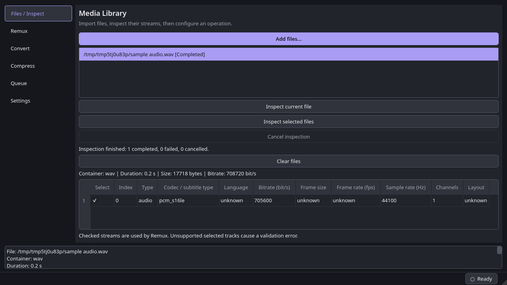
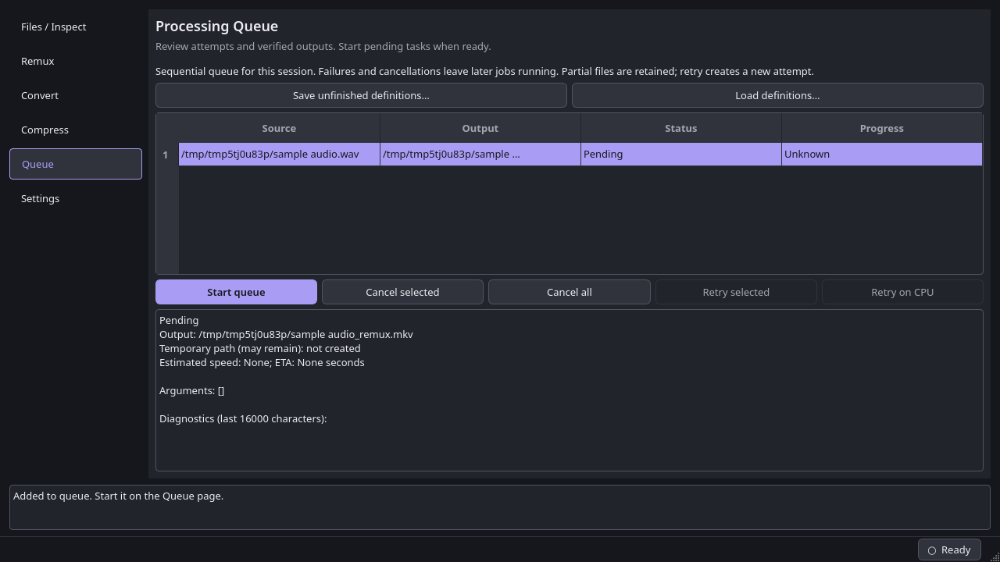
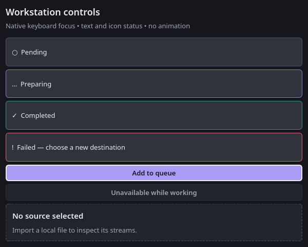

# R2 — Theme and reusable controls

Completed 2026-10-18. This phase applies the workstation visual foundation to
all six existing pages. The structural workspace migration follows in R3.

## Changes

- Central immutable color/spacing/type tokens in `ui/theme/tokens.py`, packaged
  QSS and checkbox SVG in `resources/`, and a cached, window-scoped theme loader.
- Reusable panel headers, action buttons, status chips, empty states and labeled
  field rows in `ui/widgets/controls.py`, demonstrated in the existing views.
- Dark panels, purple primary actions, readable selection, hover/focus/disabled
  styles, explicit validation errors and a text/icon busy indicator.
- Library and queue empty states; label buddies and accessible names for shared
  controls. Native Qt keyboard activation and existing widget signals remain.
- Existing domain, application and infrastructure code is unchanged. Commands,
  validation, queue execution, inspection, profiles and settings retain their
  existing service paths. No additional GUI framework or playback is introduced.

## Verification

- Full pytest suite: **339 passed**, including ten new presentation cases for
  scoped resource loading, native keyboard activation, disabled controls, status
  text, label buddies, contrast and shell empty/busy/validation transitions.
- Ruff and `git diff --check`: passed.
- Linux Qt offscreen smoke: real FFmpeg detection, generated WAV import and
  FFprobe inspection, and pending Remux enqueue. All six pages fit requested
  window sizes 900×650, 1280×720 and 1920×1080 at scale factors 1 and 2.
- Screenshot review of the library, operation settings, queue and shared control
  states. Focus, disabled, error and loading states retain text/icon distinctions;
  hover rules are checked in QSS. Normal text token pairs meet 4.5:1 contrast.
- Wheel build succeeded; archive contains the QSS, SVG and both new UI packages.
  The existing PyInstaller resource-directory collection includes these assets;
  a new frozen build was not exercised in this phase.

Native Windows styling, physical high-DPI monitors, screen-reader behavior and
interactive mouse hover still need platform verification during R6. Offscreen
checks are not evidence of native Windows rendering. No layout persistence is
added in R2; that belongs to R3.

## Screenshots

## Next phase

R3: toolbar and mode navigation, nested splitters, bottom tab switcher, persistent
layout and a shared workspace shell. Follow the workflow mappings and parity risks
in [UI migration map](UI_MIGRATION_MAP.md). Keep existing operation controls and
backend entry points while wrapping them in the new layout.
