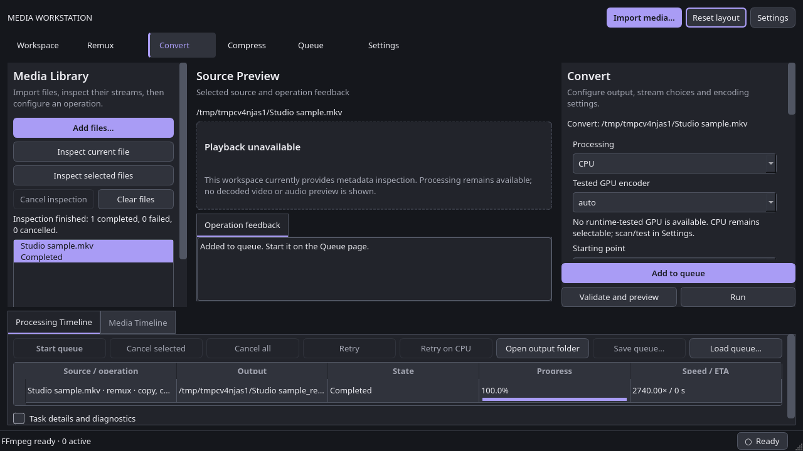
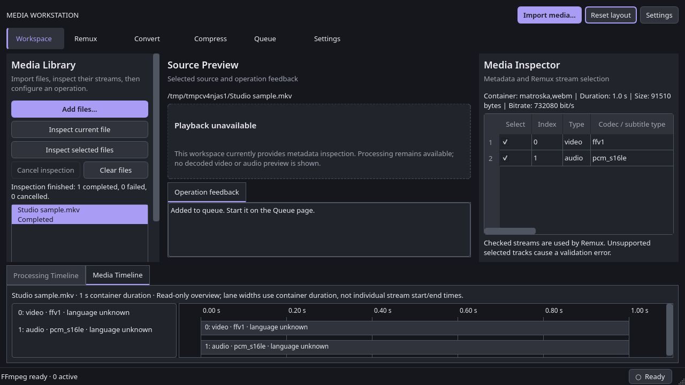

# R6 — Workstation rollout and remaining acceptance gates

Implementation and local verification: 2026-10-18. The workstation is now the
default interface. R3–R6 were implemented and committed sequentially; FFmpeg
execution, probing, command generation and publication services were preserved.

## Final UI

- Persistent three-panel workspace, mode navigation and dual bottom timelines.
- Shared Library selection, model-backed media/tasks, contextual metadata and
  operation Inspector. Import/drop starts asynchronous inspection.
- Add to Queue, Validate and Run stay visible while operation settings scroll.
  Advanced profiles, encoding, preservation, track order and batch options remain.
- Processing tracks use actual queue progress. Details expand to errors, argv,
  retained partial paths, verified result and bounded diagnostics. Direct Remux
  has a separate live status/cancel control and is never misrepresented as queued.
- Status bar shows binary availability, active count and active queue encoders.
  Settings retains full paths, versions, capability testing and diagnostics.
- Ctrl+O imports; Alt+1…6 selects modes; Ctrl+Enter starts pending jobs;
  Ctrl+Shift+L resets layout. Native Tab/Space navigation is retained.
- Source Preview deliberately uses an explicit playback-unavailable fallback.
  The original app had FFmpeg argument preview only. No playback, seek, decoded
  thumbnails or waveforms are claimed; command preview remains in the Inspector.
- Existing configuration forms are reused as contextual panels. The old sidebar
  composition is removed; those forms are retained to preserve functionality.

## Verification evidence

| Check | Result |
| --- | --- |
| Full source pytest suite, Linux / Python 3.14 | 351 passed in 19.39 s |
| Workspace/theme/model/timeline/polish tests at scale factor 2 | 22 passed |
| Ruff and git diff whitespace checks | Passed |
| Real two-stream fixture import and FFprobe inspection | Passed |
| Real queued Remux and verified completion | Passed |
| All six modes × both timeline tabs, 960×640 / 1280×720 / 1920×1080, scale 1 and 2 | Passed using Qt offscreen |
| Wheel build and isolated installed-wheel startup smoke | Passed |
| Native Windows rendering, restart, OS dialogs and file manager | Pending |
| Physical high-DPI monitor and screen-reader review | Pending |
| Hosted Linux/Windows Python 3.11/3.14 jobs | Not run in this session |

The existing test suite continues to cover missing FFmpeg/encoders, validation,
failures, cancellation/retry, profile/queue exchange, output protection and real
media operations. New cases cover a 10,000-file Library model, long names and
full-path tooltips, shared selection, validated immutable enqueue, unknown timing,
stream indices, tab switching, progress, verified-only output actions, missing or
corrupt layout state, keyboard mode selection, and visible operation actions.
The CI matrix now also runs focused workstation tests at scale 2 on both OSes.
No native Windows or frozen-package result is inferred from offscreen Linux tests.

## Workflow parity review

All W01–W30 mappings in [the migration map](UI_MIGRATION_MAP.md) have live entry
points in the new shell:

| Audit workflows | Current destination / evidence |
| --- | --- |
| W01–W02, W27–W28 | Settings mode: binaries/sidecar, capabilities, logging and diagnostic exports; existing shell/capability tests |
| W03–W06 | Import toolbar and Library; Inspector metadata, Preview feedback and Media Timeline; library/inspection tests |
| W07–W11 | Remux Inspector and pinned actions; direct Remux status/cancel also in Processing panel; remux/shell tests |
| W12–W22 | Convert/Compress Inspector, Advanced settings and batch disclosure, pinned actions; conversion/profile/batch/snapshot tests |
| W23–W26 | Processing Timeline text table/progress tracks, toolbar/context actions and expandable diagnostics; queue/timeline/shell tests |
| W29–W30 | Feedback, validation, status bar, guarded shutdown, JSON preferences and separate QSettings layout; settings/workspace/startup tests |

## Screenshots

## Remaining acceptance work

R6 is **locally verified, with cross-platform acceptance still open**. On a native
Windows machine, run the full suite and focused scale-2 suite, then launch the app
at 1280×720 and 1080p. Verify keyboard focus, native dialogs, file-manager opening,
Unicode paths, drag/drop, resizing, layout save/reopen/reset, missing binaries and
cancellation. Record OS/Qt/DPI details and outcomes here before checking the final
Windows/polish acceptance item. Repeat physical-display accessibility checks on
Linux. No additional backend or UI framework rewrite is needed for these checks.

Optional actual media playback is future work beyond the explicit R6 fallback;
it must preserve processing when the local multimedia backend cannot decode media.
